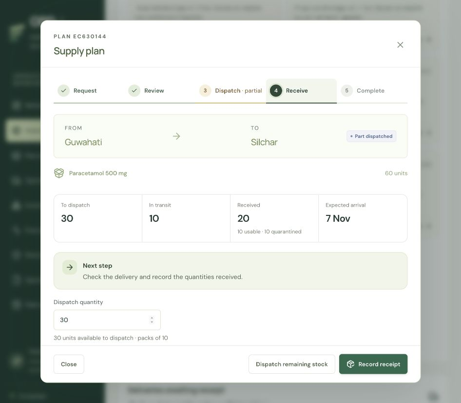

# Operational interface update — 3 November 2026

The interface now organises work around the user's current task, next action and recorded outcome. The existing Render API and database contract are retained.

## Supply orders

- One shared journey: Request → Review → Dispatch → Receive → Complete.
- The active step follows the user's permitted next action. A partial dispatch stays explicitly marked as partial while its delivery is received.
- Separate totals show units still to dispatch, in transit and received; damaged receipts are distinguished from usable stock.
- Approval, dispatch and receipt keep the user in the order journey. Completing a receipt returns to its parent plan.
- One primary footer action, with remaining dispatches as a secondary action when receiving a partial delivery.
- Batch allocation, policy detail, revalidation and cancellation are expandable. Cancellation releases unshipped reservations and preserves in-transit deliveries.
- The action centre filters Review, Dispatch, Receive, Completed and Exceptions. Part-dispatched orders can appear in both relevant work queues.
- Delivery timing warnings remain visible rather than being buried under source choices.

## Receipt consistency

Action centre and Dispatch & delivery now use the same receiving form and existing `/shipments/{id}/proof` API. It captures receiver name, document reference, checked quantities, accepted/damaged units and optional short-line evidence. Unreceived units remain in transit; the interface does not mark them delivered.

## Other operations

Supplier orders, return transfers and stock counts use the same visual progress pattern. Supplier and return transitions keep the selected record open and use the server-returned version for the next action. Finished records stop showing irrelevant supplier/return input fields.

Supplier lead and coverage assumptions are editable and are sent to both suggestion and order APIs. The draft quantity comes from the server suggestion or explicit user entry. Unit cost starts from the selected catalogue record when available.

## Less visual noise

- Task names replace promotional screen headings.
- Repeated MVP/demo qualifications are removed from routine task surfaces. Actual source records and the Data sources workspace retain provenance and limitations.
- Technical explanations move into expandable details.
- The daily risk grid is available under Daily stock timeline instead of repeating a second expanded network table.
- Android's More screen groups forecasts, assistant, activity and source information into expandable sections.
- Account, freshness, data-integrity, offline and stock-changing confirmation information stays available where it affects a decision.

## Reduced hardcoding

Initial medicine/site choices use existing open requests and catalogue records, without matching specific medicine or town names. A new supply proposal starts with one product pack rather than a fixed six-pack quantity. Supplier lead/coverage controls replace fixed request values. Development API origin and local login email can be configured through `GRD_DEV_API_ORIGIN` and `GRD_DEV_LOGIN_EMAIL`; the production API origin remains configurable as before.

Android retains its build-time HTTPS origin and editable server connection. The hosted API, data seed, inventory rules, authentication, migrations and existing application IDs remain compatible.

## Verification

- Website: 28 tests passed, including progression, site permissions, partial quantities, cancellation with an outstanding shipment and supplier version continuity; production build passed.
- Backend: 69 SQLite tests passed; the dedicated PostgreSQL-only test was skipped locally. No backend or migration source changed.
- Android: existing 13 offline/transport tests passed; TypeScript and Expo lint passed.
- Local browser: created a request/plan, approved it, dispatched 30 of 60 units, then received 10 usable and 10 damaged units with a checked receiver and short-line reference. The plan correctly retained 30 unshipped and 10 in transit. These checks used an isolated local scenario, not the hosted operating database.
- Android native release configuration: version 1.3.0 / version code 4; same package identity and hosted API origin. Native build/installation evidence is recorded separately when completed.

The UI changes do not turn generated records into observed company data or establish measured business outcomes. Physical-phone field acceptance remains separate from interface and automated checks.
